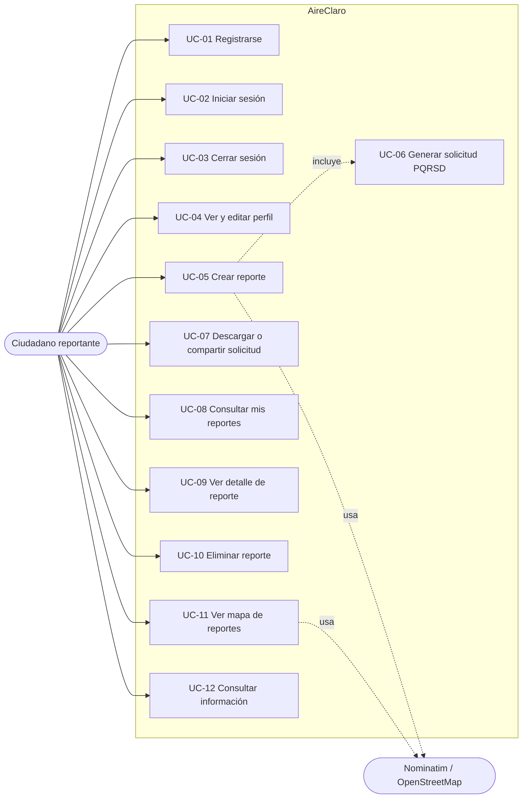
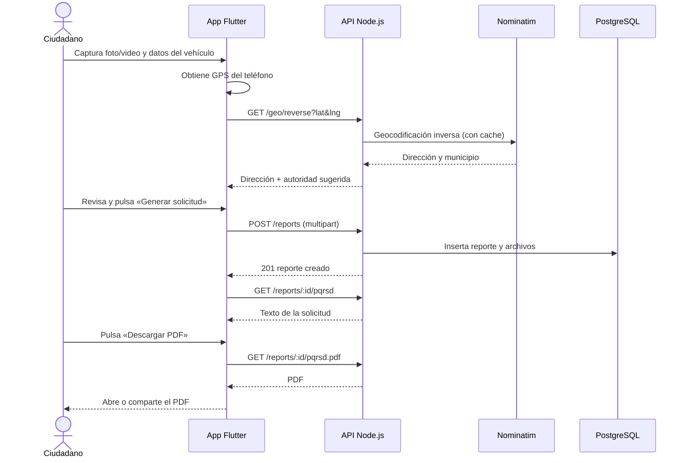

# 03 · Casos de uso

## Actores
- **Ciudadano reportante:** motociclista, ciclista o peatón del corredor. Usa la app con una cuenta.
- **Servicios externos (secundarios):** OpenStreetMap (mapa) y Nominatim (dirección a partir de coordenadas).
- **Autoridad destinataria:** recibe el PDF fuera del sistema. No es un actor del sistema.

## Diagrama general

## Secuencia: crear reporte y generar la solicitud

## Especificaciones

### UC-01 Registrarse
- **Actor:** ciudadano. **Precondición:** no tiene sesión.
- **Flujo principal:** 1) Elige «Crear cuenta». 2) Ingresa nombre, tipo y número de documento, correo,
  teléfono (opcional), contraseña y confirmación. 3) Marca la aceptación del tratamiento de datos.
  4) Pulsa «Crear cuenta». 5) El sistema crea la cuenta, guarda la fecha de consentimiento e inicia sesión.
- **Alternos:** a) Correo ya registrado → error en el campo. b) Contraseñas distintas o débiles → error.
  c) Sin conexión → mensaje y botón «Reintentar».
- **Postcondición:** cuenta creada y sesión abierta (pantalla Inicio). **Requerimientos:** RF-01, RF-11.

### UC-02 Iniciar sesión
- **Flujo:** correo y contraseña → «Ingresar» → Inicio. **Alterno:** credenciales incorrectas → mensaje genérico.
- **Postcondición:** sesión persistente (token guardado en almacenamiento seguro). **Req.:** RF-01.

### UC-03 Cerrar sesión
- **Flujo:** Perfil → «Cerrar sesión» → se borra el token → Bienvenida. **Req.:** RF-13.

### UC-04 Ver y editar perfil
- **Flujo:** Perfil muestra datos; «Editar» permite cambiar nombre, documento y teléfono; el correo no se edita.
  **Alterno:** datos inválidos → errores en campo. **Req.:** RF-13.

### UC-05 Crear reporte
- **Actor:** ciudadano; servicios externos. **Precondición:** sesión iniciada.
- **Flujo principal:**
  1. Pulsa «Nuevo reporte».
  2. **Paso 1 Evidencia:** toma foto, graba video (≤ 15 s) o elige de la galería (1 a 3 archivos).
  3. **Paso 2 Vehículo:** elige tipo, escribe placa, elige color del humo, descripción opcional.
  4. **Paso 3 Ubicación:** la app obtiene el GPS; muestra mapa y dirección; el usuario puede ajustar el pin.
  5. **Paso 4 Peticionario:** datos precargados desde el perfil (editables).
  6. **Revisión:** ve el resumen y la autoridad sugerida (puede cambiarla).
  7. Pulsa «Generar solicitud»; el sistema guarda el reporte y sus archivos y asigna la autoridad.
- **Alternos:** a) Sin permiso de cámara o ubicación → aviso y acceso a ajustes. b) Placa inválida → error.
  c) Archivo demasiado grande → error. d) Sin conexión al guardar → mensaje y «Reintentar» (no hay borradores).
  e) No se pudo determinar la autoridad → el usuario elige de una lista.
- **Postcondición:** reporte guardado con estado `generado`. **Incluye:** UC-06. **Req.:** RF-02…RF-05, RF-07.

### UC-06 Generar solicitud PQRSD
- **Disparador:** reporte guardado. **Flujo:** el sistema compone el texto con los datos del reporte y la
  plantilla de `docs/05`, y muestra la vista previa. **Postcondición:** el PDF puede descargarse. **Req.:** RF-06.

### UC-07 Descargar o compartir la solicitud
- **Flujo:** en la vista previa o en el detalle, «Descargar PDF» abre el archivo; «Compartir» abre el menú del
  teléfono. El usuario puede marcar el reporte como «enviado». **Alterno:** error de red → «Reintentar».
  **Req.:** RF-08.

### UC-08 Consultar mis reportes
- **Flujo:** pestaña «Mis reportes» → lista paginada (más reciente primero). **Alterno:** sin reportes →
  estado vacío con botón «Nuevo reporte». **Req.:** RF-09.

### UC-09 Ver detalle de reporte
- **Flujo:** toca un reporte → ve evidencia, datos, mapa pequeño, autoridad, estado y botones de descarga.
  **Req.:** RF-15.

### UC-10 Eliminar reporte
- **Flujo:** en el detalle, «Eliminar» → confirmación → el reporte y sus archivos se borran. **Req.:** RF-16.

### UC-11 Ver mapa de reportes
- **Flujo:** pestaña «Mapa» → pines de reportes; filtros por tipo y fechas; al tocar un pin, tarjeta con tipo,
  fecha y lugar. No se muestran placa ni fotos. **Req.:** RF-10.

### UC-12 Consultar información
- **Flujo:** pestaña «Info» → pasos, autoridades y alcance. **Req.:** RF-14.
