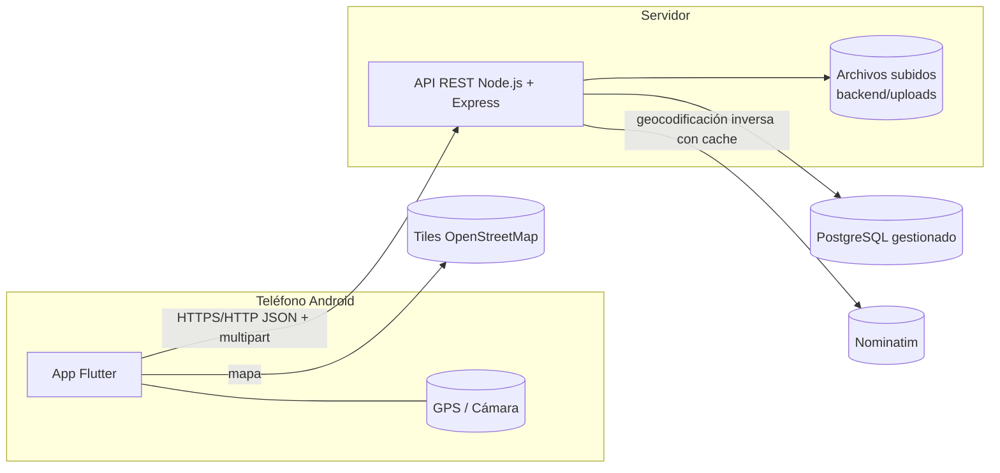

# 04 · Arquitectura y stack

## Vista general



Estilo: cliente–servidor, API REST con JSON. La app no habla con la base de datos ni con Nominatim:
todo pasa por el API.

## Decisiones técnicas

| # | Decisión | Motivo | Alternativa descartada |
|---|---|---|---|
| D-01 | Flutter (Android) | Ya declarado en el documento maestro; una base de código; acceso a cámara y GPS | App nativa; web |
| D-02 | Node.js + Express | Ya declarado; simple y conocido por Mateo | NestJS (más complejo para el plazo) |
| D-03 | PostgreSQL gestionado en la nube | Entorno relevante para TRL 5, sin instalar un servidor local | PostgreSQL local (plan B) |
| D-04 | OpenStreetMap + `flutter_map` | Gratuito, sin cuenta de facturación | Google Maps Platform |
| D-05 | Nominatim vía el API, con cache | Respeta la política de uso (1 petición/s, `User-Agent`) | Llamarlo desde la app |
| D-06 | JWT sin refresco, vigencia 7 días | Simplicidad para el prototipo | Sesiones con refresh tokens |
| D-07 | PDF generado en el servidor con `pdfkit` | El mismo PDF para la vista previa y la descarga; la app no necesita librerías de PDF | Generarlo en la app |
| D-08 | Archivos en disco del servidor (`uploads/`) | Más simple que almacenamiento en la nube | Almacenamiento de objetos |
| D-09 | `lat` y `lng` como columnas numéricas | Suficiente para el MVP | PostGIS (mejora futura) |
| D-10 | Riverpod para el estado y `go_router` para la navegación | Patrón claro y ampliamente usado | Provider, Bloc |
| D-11 | Monorepo (`backend/`, `app/`, `docs/`) | Un solo repositorio que el tutor puede revisar | Dos repositorios |

> Cualquier cambio a esta tabla se registra aquí con la fecha y el motivo.

## Paquetes sugeridos

**API (`backend/`)**: `express`, `cors`, `helmet`, `express-rate-limit`, `pg`, `dotenv`, `bcryptjs`,
`jsonwebtoken`, `multer`, `pdfkit`, `zod`, `node-pg-migrate`. Desarrollo: `nodemon`, `jest`, `supertest`.

**App (`app/`)**: `flutter_riverpod`, `go_router`, `dio`, `flutter_secure_storage`, `image_picker`,
`geolocator`, `permission_handler`, `flutter_map`, `latlong2`, `share_plus`, `open_filex`, `path_provider`,
`intl`. Verifica las versiones compatibles con `flutter pub add` y justifica en este archivo cualquier
paquete adicional.

## Estructura del backend

```
backend/
├── package.json
├── .env.example
├── src/
│   ├── server.js            # arranque
│   ├── app.js               # Express, middlewares, rutas
│   ├── config/env.js        # lectura y validación de variables de entorno
│   ├── db/
│   │   ├── pool.js
│   │   ├── migrations/      # SQL versionado
│   │   └── seed/            # autoridades
│   ├── middleware/          # auth, errores, validación, límites, subida de archivos
│   ├── modules/
│   │   ├── auth/  users/  reports/  authorities/  geo/  map/  pqrsd/
│   │   └── (cada módulo: routes, controller, service, schema)
│   └── utils/
├── uploads/                 # NO versionado
└── tests/
```

## Estructura de la app

```
app/
├── pubspec.yaml
├── lib/
│   ├── main.dart
│   ├── app.dart
│   ├── core/        # config, theme, router, cliente HTTP, almacenamiento seguro, validadores
│   ├── features/    # auth, home, report, history, map, info, profile
│   └── shared/      # widgets reutilizables
└── test/
```

## Variables de entorno del backend (`backend/.env.example`, sin valores reales)

| Variable | Ejemplo / nota |
|---|---|
| `PORT` | `3000` |
| `DATABASE_URL` | Cadena de conexión del proveedor (**secreto**) |
| `DATABASE_SSL` | `true` si el proveedor lo exige |
| `JWT_SECRET` | Cadena larga y aleatoria (**secreto**) |
| `JWT_EXPIRES_IN` | `7d` |
| `UPLOAD_DIR` | `./uploads` |
| `MAX_PHOTO_MB` / `MAX_VIDEO_MB` | `8` / `25` |
| `NOMINATIM_BASE_URL` | `https://nominatim.openstreetmap.org` |
| `NOMINATIM_USER_AGENT` | `AireClaro-UNAD/1.0 (contacto: <correo de Mateo>)` |
| `CORS_ORIGIN` | `*` en desarrollo |

## Configuración de la app
La URL del API se pasa al compilar: `flutter run --dart-define=API_BASE_URL=http://localhost:3000/api`.

### Cómo conecta el celular al API en el equipo de Mateo (desarrollo)
- **Opción recomendada (USB):** con el celular conectado y la depuración USB activa, ejecutar
  `adb reverse tcp:3000 tcp:3000`. Así `http://localhost:3000` en el teléfono llega al API del PC.
- **Opción Wi-Fi:** usar la IP local del PC (ej. `http://192.168.x.x:3000/api`) con ambos en la misma red y
  permitir el puerto 3000 en el firewall de Windows (red privada).
- **Emulador:** `http://10.0.2.2:3000/api`.
- Android bloquea HTTP sin cifrar por defecto: para desarrollo se habilita `android:usesCleartextTraffic="true"`
  **solo en el manifiesto de debug/profile** (`app/android/app/src/debug/AndroidManifest.xml`). En producción
  se usa HTTPS.

### Permisos de Android (AndroidManifest principal)
`INTERNET`, `CAMERA`, `ACCESS_FINE_LOCATION`, `ACCESS_COARSE_LOCATION`. La app debe pedir los permisos en el
momento de usarlos y explicar para qué.

## Base de datos en la nube (Sprint 0)
Elegir un proveedor de PostgreSQL gestionado con plan gratuito **verificando sus condiciones vigentes el
mismo día** (límites de almacenamiento, pausa por inactividad, SSL). Criterios: soporta conexión con una URL
estándar, no exige tarjeta de crédito, permite crear tablas con SQL. Registrar aquí el proveedor elegido y
guardar la cadena de conexión **solo** en `backend/.env`.
**Plan B:** instalar PostgreSQL en Windows y usar `DATABASE_URL=postgres://...@localhost:5432/aireclaro`.

## Seguridad (resumen)
- Contraseñas con `bcryptjs`; JWT firmado con secreto del entorno; verificación del dueño en cada recurso (RB-01).
- `helmet`, límite de peticiones (global y más estricto en `/auth`), validación de entradas con `zod`.
- Archivos: validar tipo MIME y tamaño; nombres de archivo generados por el servidor (UUID); no se sirven
  desde una carpeta pública, solo mediante un endpoint autenticado.
- Sin secretos ni datos personales en el repositorio ni en los logs.

## Despliegue
1. **Desarrollo y demo (mínimo):** API en el PC de Mateo + BD en la nube + celular por USB (`adb reverse`).
2. **Opcional (Could):** desplegar el API en un servicio gratuito de alojamiento (verificar condiciones al
   momento) y apuntar la app a esa URL con HTTPS. Los archivos en disco pueden perderse en reinicios: es
   aceptable para la demo.
3. **APK:** `flutter build apk` para instalar la app sin cable durante la demo (Could).
