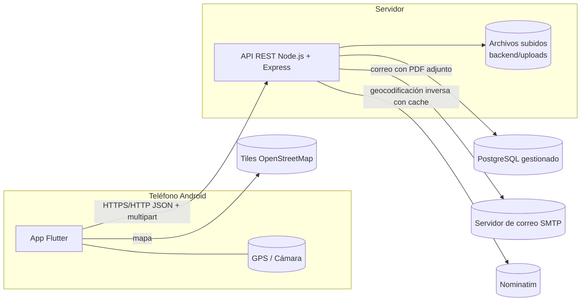

# 04 · Arquitectura y stack

## Vista general



Estilo: cliente–servidor, API REST con JSON. La app no habla con la base de datos ni con Nominatim:
todo pasa por el API.

## Decisiones técnicas

| # | Decisión | Motivo | Alternativa descartada |
|---|---|---|---|
| D-01 | Flutter (Android) | Ya declarado en el documento maestro; una base de código; acceso a cámara y GPS | App nativa; web |
| D-02 | Node.js + Express | Ya declarado; simple y conocido por Mateo | NestJS (más complejo para el plazo) |
| D-03 | PostgreSQL gestionado en la nube | Entorno relevante para TRL 5, sin instalar un servidor local | PostgreSQL local (plan B) |
| D-04 | OpenStreetMap + `flutter_map` | Gratuito, sin cuenta de facturación | Google Maps Platform |
| D-05 | Nominatim vía el API, con cache | Respeta la política de uso (1 petición/s, `User-Agent`) | Llamarlo desde la app |
| D-06 | JWT sin refresco, vigencia 7 días | Simplicidad para el prototipo | Sesiones con refresh tokens |
| D-07 | PDF generado en el servidor con `pdfkit` | El mismo PDF para la vista previa y la descarga; la app no necesita librerías de PDF | Generarlo en la app |
| D-08 | Archivos en disco del servidor (`uploads/`) | Más simple que almacenamiento en la nube | Almacenamiento de objetos |
| D-09 | `lat` y `lng` como columnas numéricas | Suficiente para el MVP | PostGIS (mejora futura) |
| D-10 | Riverpod para el estado y `go_router` para la navegación | Patrón claro y ampliamente usado | Provider, Bloc |
| D-11 | Monorepo (`backend/`, `app/`, `docs/`) | Un solo repositorio que el tutor puede revisar | Dos repositorios |
| D-12 | Envío de la solicitud por correo SMTP desde el API (`nodemailer`) | La Ley 1755/2015 art. 15 admite petición por medio electrónico; no depende de portales sin API | Scraping de portales (frágil y riesgoso); WhatsApp Business API (aprobación y costo) |
| D-13 | `MAIL_MODE=test` por defecto | Evita radicar denuncias reales por accidente durante desarrollo y video | Enviar siempre a la autoridad |
| D-14 | Botón al portal oficial (`url_launcher`) como vía alterna | Los portales dan número de radicado explícito; no se automatizan | Scraper del portal |
| D-15 | Semillas de autoridades como segunda migración SQL de `node-pg-migrate` (16-nov-2026) | Quedan versionadas junto al esquema y se aplican con un solo comando (`npm run migrate`), en orden y una sola vez | Carpeta `db/seed/` con un script aparte |
| D-16 | Material como paquete `material_ui` (import `package:material_ui/material_ui.dart`) (16-nov-2026) | Flutter 3.50 separó Material del framework y la plantilla de `flutter create` ya lo usa | Import antiguo `package:flutter/material.dart` |
| D-17 | Ruta `/splash` adicional y `android:allowBackup="false"` (16-nov-2026) | `/splash` valida el token con `GET /me` al abrir (sesión persistente con «Reintentar» sin red); sin respaldo automático el token cifrado no se restaura en otro equipo (recomendación de `flutter_secure_storage`) | Abrir directo en `/home` sin validar el token |

> Cualquier cambio a esta tabla se registra aquí con la fecha y el motivo.

## Paquetes sugeridos

**API (`backend/`)**: `express`, `cors`, `helmet`, `express-rate-limit`, `pg`, `dotenv`, `bcryptjs`,
`jsonwebtoken`, `multer`, `pdfkit`, `zod`, `node-pg-migrate`, `nodemailer`. Desarrollo: `nodemon`, `jest`, `supertest`.

**App (`app/`)**: `flutter_riverpod`, `go_router`, `dio`, `flutter_secure_storage`, `image_picker`,
`geolocator`, `permission_handler`, `flutter_map`, `latlong2`, `share_plus`, `open_filex`, `path_provider`, `url_launcher`,
`intl`. Verifica las versiones compatibles con `flutter pub add` y justifica en este archivo cualquier
paquete adicional.

**Instalados en la app (Sprint 1, 16-nov-2026):** `material_ui` 1.11 (de la plantilla, D-16), `flutter_riverpod` 3.5 (sin generación de código), `go_router` 18.1, `dio` 5.11, `flutter_secure_storage` 11.2. Los demás se agregan con la historia que los use. Pruebas sin paquetes de mocks: dobles escritos a mano en `app/test/helpers/`.

**Agregados en el Sprint 2:**
- `multer` (API, US-05): recibir `multipart/form-data` con límites de cantidad y tamaño, guardando en disco con
  nombres generados. El tipo real se verifica leyendo los primeros bytes del archivo (`src/utils/fileType.js`, sin
  paquete adicional).
- `image_picker` (app, US-05): tomar foto, grabar video (máx. 15 s) y elegir de la galería; reduce las fotos a
  1600 px de lado y calidad 80 (RNF-02).
- `geolocator` (app, US-07): posición GPS y permiso de ubicación (pedirlo, abrir los ajustes); por eso no se usa
  `permission_handler`.
- `flutter_map` + `latlong2` (app, US-07): mapa con tiles de OpenStreetMap y pin (D-04). Atribución
  «© OpenStreetMap contributors» siempre visible y `userAgentPackageName = com.aireclaro.app`.
- `intl` (app, US-07): fecha y hora en formato de Colombia (`es_CO`).

**Agregados en el Sprint 3:**
- `pdfkit` (API, US-12): genera el PDF de la solicitud en el servidor (D-07).
- `pdf-parse` (API, solo desarrollo, US-12): las pruebas leen el texto del PDF generado para verificar el
  contenido del art. 16 y que tildes, eñ y signos («», ¿, n.º) salgan bien.
- `path_provider` (app, US-13): carpeta temporal donde se guarda el PDF descargado.
- `open_filex` (app, US-13): abre el PDF (y los videos de evidencia, CP-07) con la app del teléfono.
- `share_plus` (app, US-13): menú «Compartir» del teléfono con el PDF.
- `fc_native_video_thumbnail` (app, US-23): extrae fotogramas JPEG de un video en un instante dado (API nativa de
  Android). Se descartó `video_thumbnail` (no es compatible con Dart 3).
- `video_player` (app, US-23): **solo para leer la duración** del video y calcular el 10 %, 35 %, 65 % y 90 %; la
  app sigue sin reproducir videos (revisa la decisión del 16-nov-2026: «sin `video_player`» era para mostrar la
  duración; ahora la exige US-23, aprobada por Mateo el 17-nov-2026).
- `nodemailer` (API, US-21): envía la solicitud por SMTP (D-12). En las pruebas automáticas se reemplaza por un
  transporte simulado: nunca sale un correo real desde `npm test`.
- `url_launcher` (app, US-22): abre el portal oficial de la autoridad en el navegador del teléfono (D-14).

## Estructura del backend

```
backend/
├── package.json
├── .env.example
├── src/
│   ├── server.js            # arranque
│   ├── app.js               # Express, middlewares, rutas
│   ├── config/env.js        # lectura y validación de variables de entorno
│   ├── db/
│   │   ├── pool.js
│   │   └── migrations/      # SQL versionado (node-pg-migrate), incluye las semillas de autoridades (D-15)
│   ├── middleware/          # auth, errores, validación, límites, subida de archivos
│   ├── modules/
│   │   ├── auth/  users/  reports/  authorities/  geo/  map/  pqrsd/
│   │   └── (cada módulo: routes, controller, service, schema)
│   └── utils/
├── uploads/                 # NO versionado
└── tests/
```

## Estructura de la app

```
app/
├── pubspec.yaml
├── lib/
│   ├── main.dart
│   ├── app.dart
│   ├── core/        # config, theme, router, cliente HTTP, almacenamiento seguro, validadores
│   ├── features/    # auth, home, report, history, map, info, profile
│   └── shared/      # widgets reutilizables
└── test/
```

## Variables de entorno del backend (`backend/.env.example`, sin valores reales)

| Variable | Ejemplo / nota |
|---|---|
| `PORT` | `3000` |
| `DATABASE_URL` | Cadena de conexión del proveedor (**secreto**) |
| `DATABASE_SSL` | `true` si el proveedor lo exige |
| `JWT_SECRET` | Cadena larga y aleatoria (**secreto**) |
| `JWT_EXPIRES_IN` | `7d` |
| `UPLOAD_DIR` | `./uploads` |
| `MAX_PHOTO_MB` / `MAX_VIDEO_MB` | `8` / `25` |
| `NOMINATIM_BASE_URL` | `https://nominatim.openstreetmap.org` |
| `NOMINATIM_USER_AGENT` | `AireClaro-UNAD/1.0 (contacto: <correo de Mateo>)` |
| `CORS_ORIGIN` | `*` en desarrollo |
| `MAIL_MODE` | `test` (por defecto) · `live` · `off` |
| `MAIL_TEST_TO` | Buzón de prueba de Mateo (recibe todo en modo `test`) |
| `SMTP_HOST` / `SMTP_PORT` | Del proveedor de correo elegido |
| `SMTP_USER` / `SMTP_PASS` | **Secretos** del proveedor |
| `MAIL_FROM` | Remitente del sistema, p. ej. `AireClaro <direccion-verificada@dominio>` |

## Configuración de la app
La URL del API se pasa al compilar: `flutter run --dart-define=API_BASE_URL=http://localhost:3000/api`.

### Cómo conecta el celular al API en el equipo de Mateo (desarrollo)
- **Opción recomendada (USB):** con el celular conectado y la depuración USB activa, ejecutar
  `adb reverse tcp:3000 tcp:3000`. Así `http://localhost:3000` en el teléfono llega al API del PC.
- **Opción Wi-Fi:** usar la IP local del PC (ej. `http://192.168.x.x:3000/api`) con ambos en la misma red y
  permitir el puerto 3000 en el firewall de Windows (red privada).
- **Emulador:** `http://10.0.2.2:3000/api`.
- Android bloquea HTTP sin cifrar por defecto: para desarrollo se habilita `android:usesCleartextTraffic="true"`
  **solo en el manifiesto de debug/profile** (`app/android/app/src/debug/AndroidManifest.xml`). En producción
  se usa HTTPS.

### Permisos de Android (AndroidManifest principal)
`INTERNET`, `ACCESS_FINE_LOCATION`, `ACCESS_COARSE_LOCATION`. La app debe pedir los permisos en el momento de
usarlos y explicar para qué. **`CAMERA` no se declara** (16-nov-2026, aprobado por Mateo): `image_picker` usa la
app de cámara del sistema, que no necesita el permiso; si se declarara, Android obligaría a pedirlo antes de abrirla.

## Base de datos en la nube (Sprint 0)
Elegir un proveedor de PostgreSQL gestionado con plan gratuito **verificando sus condiciones vigentes el
mismo día** (límites de almacenamiento, pausa por inactividad, SSL). Criterios: soporta conexión con una URL
estándar, no exige tarjeta de crédito, permite crear tablas con SQL. Registrar aquí el proveedor elegido y
guardar la cadena de conexión **solo** en `backend/.env`.
**Plan B:** instalar PostgreSQL en Windows y usar `DATABASE_URL=postgres://...@localhost:5432/aireclaro`.

## Correo saliente (Sprint 3)
- El API envía con `nodemailer` por SMTP. **Proveedor:** elegir uno con plan gratuito verificando sus condiciones
  vigentes el mismo día (límites diarios, verificación del remitente, tarjeta no obligatoria). Plan B: SMTP de una
  cuenta de correo propia con contraseña de aplicación. Registrar aquí el elegido, sin credenciales.
  **Elegido (17-nov-2026):** Gmail con contraseña de aplicación (plan B). Mateo llena `SMTP_*`, `MAIL_FROM` y
  `MAIL_TEST_TO` (su propio buzón) en `backend/.env`; nunca se escriben en el repositorio.
- Remitente `MAIL_FROM`; `Reply-To` y `Cc` = correo del ciudadano; asunto y cuerpo según `docs/05`.
- Adjuntos: el PDF siempre; la evidencia (fotos/video) solo si el total ≤ 15 MB; si no, solo el PDF y el cuerpo
  indica que la evidencia está disponible a solicitud.
- Modos: `test` (todo va a `MAIL_TEST_TO`, asunto con prefijo `[PRUEBA]`), `live` (a la autoridad, solo si
  `email_verified`), `off` (no envía). El modo vigente se muestra al usuario en la app.

## Seguridad (resumen)
- Contraseñas con `bcryptjs`; JWT firmado con secreto del entorno; verificación del dueño en cada recurso (RB-01).
- `helmet`, límite de peticiones (global y más estricto en `/auth`), validación de entradas con `zod`.
- Archivos: validar tipo MIME y tamaño; nombres de archivo generados por el servidor (UUID); no se sirven
  desde una carpeta pública, solo mediante un endpoint autenticado.
- Sin secretos ni datos personales en el repositorio ni en los logs (tampoco las credenciales SMTP ni los cuerpos de los correos).

## Despliegue
1. **Desarrollo y demo (mínimo):** API en el PC de Mateo + BD en la nube + celular por USB (`adb reverse`).
2. **Opcional (Could):** desplegar el API en un servicio gratuito de alojamiento (verificar condiciones al
   momento) y apuntar la app a esa URL con HTTPS. Los archivos en disco pueden perderse en reinicios: es
   aceptable para la demo.
3. **APK:** `flutter build apk` para instalar la app sin cable durante la demo (Could).
