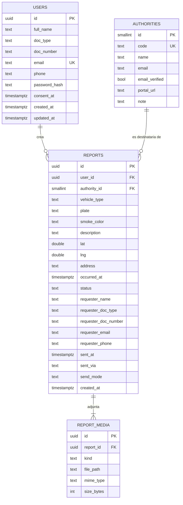

# 05 · Modelo de datos y API

## Modelo entidad–relación



## Esquema SQL inicial (`backend/src/db/migrations/001_init`)

```sql
CREATE TABLE authorities (
  id smallserial PRIMARY KEY,
  code text NOT NULL UNIQUE,
  name text NOT NULL,
  email text,
  email_verified boolean NOT NULL DEFAULT false,
  portal_url text,
  note text
);

CREATE TABLE users (
  id uuid PRIMARY KEY DEFAULT gen_random_uuid(),
  full_name text NOT NULL,
  doc_type text NOT NULL CHECK (doc_type IN ('CC','CE','PAS')),
  doc_number text NOT NULL,
  email text NOT NULL UNIQUE,
  phone text,
  password_hash text NOT NULL,
  consent_at timestamptz NOT NULL,
  created_at timestamptz NOT NULL DEFAULT now(),
  updated_at timestamptz NOT NULL DEFAULT now()
);

CREATE TABLE reports (
  id uuid PRIMARY KEY DEFAULT gen_random_uuid(),
  user_id uuid NOT NULL REFERENCES users(id) ON DELETE CASCADE,
  authority_id smallint NOT NULL REFERENCES authorities(id),
  vehicle_type text NOT NULL CHECK (vehicle_type IN ('bus','microbus','camion','tractomula','otro')),
  plate text NOT NULL,
  smoke_color text NOT NULL CHECK (smoke_color IN ('negro','gris','blanco')),
  description text,
  lat double precision NOT NULL CHECK (lat BETWEEN -90 AND 90),
  lng double precision NOT NULL CHECK (lng BETWEEN -180 AND 180),
  address text,
  occurred_at timestamptz NOT NULL,
  status text NOT NULL DEFAULT 'generado' CHECK (status IN ('generado','enviado')),
  requester_name text NOT NULL,
  requester_doc_type text NOT NULL,
  requester_doc_number text NOT NULL,
  requester_email text NOT NULL,
  requester_phone text,
  sent_at timestamptz,
  sent_via text CHECK (sent_via IN ('email','manual')),
  send_mode text CHECK (send_mode IN ('test','live')),
  created_at timestamptz NOT NULL DEFAULT now()
);
CREATE INDEX idx_reports_user_created ON reports (user_id, created_at DESC);
CREATE INDEX idx_reports_occurred ON reports (occurred_at);
CREATE INDEX idx_reports_coords ON reports (lat, lng);

CREATE TABLE report_media (
  id uuid PRIMARY KEY DEFAULT gen_random_uuid(),
  report_id uuid NOT NULL REFERENCES reports(id) ON DELETE CASCADE,
  kind text NOT NULL CHECK (kind IN ('photo','video')),
  file_path text NOT NULL,
  mime_type text NOT NULL,
  size_bytes integer NOT NULL
);
CREATE INDEX idx_media_report ON report_media (report_id);
```

**Datos iniciales (`authorities`):**

| code | name | email | portal_url | email_verified |
|---|---|---|---|---|
| `CAR` | Corporación Autónoma Regional de Cundinamarca (CAR) | `sau@car.gov.co` | `https://sidcar.car.gov.co/Modulos/Buzon/RadicarPQR.aspx` | `true` |
| `SDA` | Secretaría Distrital de Ambiente de Bogotá | `atencionalciudadano@ambientebogota.gov.co` | `https://www.bogota.gov.co/sdqs` | `true` |
| `SDM` | Secretaría Distrital de Movilidad de Bogotá | *(sin correo)* | `https://www.movilidadbogota.gov.co/radicacionwebsdm/formulario.php` | `false` |

**Origen de estos datos:** la migración `1794830400001_seed-authorities` cargó candidatos sin verificar
(investigación del 16-nov-2026). El 16-nov-2026 Mateo verificó los correos y portales en los sitios oficiales, y la
migración `1794876283606_update-authorities-verified` los dejó como aparecen arriba (aplicada en la rama `test` y
en la base principal). `email_verified = true` solo permite el envío real con `MAIL_MODE=live`, que requiere una
orden explícita de Mateo; con `MAIL_MODE=test` (por defecto) todo va a `MAIL_TEST_TO`. La SDM no tiene correo: solo
se ofrece «Radicar en el portal oficial». No inventes direcciones; cualquier cambio va en una nueva migración.

## Convenciones del API
- Prefijo `/api`. JSON en UTF-8. Fechas en ISO 8601 (UTC).
- Autenticación: cabecera `Authorization: Bearer <token>` en todo salvo `/health`, `/auth/register`, `/auth/login`.
- Errores: `{ "error": { "code": "VALIDATION_ERROR", "message": "texto en español", "details": [...] } }`
  con códigos HTTP 400, 401, 403, 404, 409, 413, 429, 500.
- Límites: peticiones globales 300 cada 15 min por IP; `/auth/*` 10 cada 15 min. (Cambio del 16-nov-2026, aprobado
  por Mateo: antes 100; cada miniatura de evidencia en «Mis reportes» es una petición autenticada.)

## Endpoints

| Método y ruta | Descripción | Cuerpo / parámetros | Respuesta |
|---|---|---|---|
| `GET /health` | Estado del servicio | — | `200 {status:"ok"}` |
| `POST /auth/register` | Crear cuenta | `full_name, doc_type, doc_number, email, phone?, password (≥8), accept_terms:true` | `201 {token, user}` · `409` correo duplicado |
| `POST /auth/login` | Iniciar sesión | `email, password` | `200 {token, user}` · `401` |
| `GET /me` | Perfil | — | `200 {user}` |
| `PUT /me` | Editar perfil | `full_name, doc_type, doc_number, phone?` | `200 {user}` |
| `GET /authorities` | Lista de autoridades | — | `200 [{id, code, name, portal_url, can_email}]` (`can_email` = tiene correo verificado; el correo no se expone) |
| `GET /geo/reverse` | Dirección desde coordenadas | `lat, lng` | `200 {address, municipality, state, suggested_authority_id}` |
| `POST /reports` | Crear reporte | `multipart/form-data`: `vehicle_type, plate, smoke_color, description?, lat, lng, address?, occurred_at, authority_id?, requester_name, requester_doc_type, requester_doc_number, requester_email, requester_phone?` + `files[]` (1–3) | `201 {report}` con `status: generado`, `authority` y `media[]` · `400` validación, tipo de archivo (`INVALID_FILE_TYPE`), más de 3 archivos (`TOO_MANY_FILES`) o sin autoridad (`AUTHORITY_REQUIRED`) · `413` archivo grande. Reporte y archivos en una sola transacción; el dueño sale del token |
| `GET /reports` | Mis reportes | `page=1, limit=20 (máx. 50), status?` | `200 {items, page, total}`, más reciente primero; cada item: `id, plate, vehicle_type, smoke_color, status, address, occurred_at, created_at, authority{code,name}, thumbnail_media_id` (una foto; `null` si solo hay videos), `media_count` |
| `GET /reports/:id` | Detalle | — | `200 {report, media[], authority}` (`authority` con `can_email`, sin el correo; `media` sin rutas de archivo) · `404` si no es suyo, no existe o el id no es válido (misma respuesta) |
| `DELETE /reports/:id` | Eliminar | — | `204` |
| `PATCH /reports/:id/status` | Marcar como enviado a mano (portal, compartir) | `{status:"enviado"}` | `200 {report}` con `sent_via=manual` |
| `GET /reports/:id/media/:mediaId` | Descargar un archivo de evidencia | — | archivo con su `Content-Type` · `404` si no es suyo, no existe o el id no es válido (misma respuesta en los tres casos) |
| `GET /reports/:id/pqrsd` | Texto de la solicitud | — | `200 {authority, text}` |
| `GET /reports/:id/pqrsd.pdf` | PDF de la solicitud | — | `200 application/pdf` |
| `POST /reports/:id/send` | Enviar la solicitud por correo a la autoridad | `{confirm:true}` | `200 {report, delivery:{mode, sent_at}}` · `409` ya enviado · `422` autoridad sin correo verificado · `502` fallo del servidor de correo |
| `GET /map/reports` | Reportes para el mapa | `vehicle_type?, from?, to?` | `200 [{id, lat, lng, vehicle_type, occurred_at}]` |

Ejemplo de respuesta de `POST /reports` (resumen):
```json
{ "report": { "id": "…", "vehicle_type": "bus", "plate": "ABC123", "smoke_color": "negro",
  "lat": 4.5794, "lng": -74.2168, "address": "…", "occurred_at": "2026-11-17T14:30:00Z",
  "status": "generado", "authority": {"id": 1, "code": "CAR", "name": "…"} } }
```

## Validaciones
- `vehicle_type`: `bus | microbus | camion | tractomula | otro`. `smoke_color`: `negro | gris | blanco`.
- `plate`: normalizar (mayúsculas, sin espacios ni guiones) y validar `^[A-Z]{3}\d{3}$` o `^[A-Z]{3}\d{2}[A-Z]$`.
- `lat` entre −90 y 90; `lng` entre −180 y 180; `occurred_at` no puede ser futura.
- `description` hasta 500 caracteres. `password` mínimo 8 caracteres. `email` con formato válido y único.
- Archivos: de 1 a 3; imágenes `image/jpeg|png|webp` ≤ 8 MB; video `video/mp4|quicktime` ≤ 25 MB.
- `accept_terms` debe ser `true`; se guarda `consent_at = now()`.

## Asignación de la autoridad (confirmada por Mateo el 16-nov-2026)
1. `GET /geo/reverse` obtiene de Nominatim (`format=jsonv2&addressdetails=1&accept-language=es&zoom=16`) la
   dirección con sus campos administrativos.
2. La regla mira **solo** los campos administrativos (`city`, `town`, `village`, `municipality`, `county`,
   `subregion`, `state_district`, `state`, `region`), nunca la calle ni el barrio: una «Avenida Bogotá» en Soacha
   o el barrio «UPZs de Bogotá» que devuelve Nominatim no deben contar. Se normaliza el texto (minúsculas, sin
   tildes). Si contiene `bogota` → **SDA**. Si contiene `soacha` o `cundinamarca` → **CAR**. Si coinciden las
   dos (caso ambiguo) o ninguna → sin sugerencia; el usuario elige. El usuario siempre puede cambiarla.
3. El servidor repite la regla al crear el reporte si no llega `authority_id`.
4. **Prueba real (16-nov-2026):** Soacha (4.579, −74.217) → `city: Soacha ciudad`, `subregion: Soacha`,
   `state: Cundinamarca` → **CAR**. Centro de Bogotá (4.610, −74.082) → `city: Bogotá ciudad`,
   `state: Bogotá, Distrito Capital` → **SDA**. Ninguno fue ambiguo. Las respuestas se guardan como datos de
   prueba en `backend/tests/helpers/nominatim.js`.
5. **Cache:** en memoria, clave = coordenadas redondeadas a 4 decimales, TTL 24 h, máximo 1000 entradas; cola
   global para no superar 1 petición por segundo; cabecera `User-Agent` desde `NOMINATIM_USER_AGENT`; tiempo
   límite 5 s. Si Nominatim falla: `502 GEOCODER_UNAVAILABLE` y la app deja continuar (la autoridad se elige en
   la revisión).

## Plantilla de la solicitud (texto y PDF)

Tamaño carta, fuente legible (Helvetica de `pdfkit`), márgenes de 2,5 cm. La primera foto del reporte se
incrusta reducida (≈ 6 cm de ancho) si existe (JPG o PNG); si solo hay video, se lista en los anexos.
**Ley 1755 de 2015, art. 16 (contenido mínimo):** autoridad (encabezado) · nombres, documento y dirección
electrónica de notificación (firma y NOTIFICACIONES) · objeto (asunto y PETICIÓN) · razones (HECHOS) · relación
de documentos (ANEXOS) · firma (nombre y documento). Encabezado solo con la fecha, sin ciudad (17-nov-2026,
aprobado por Mateo: el reporte no guarda el municipio y el art. 16 no la exige).

```
{fecha de generación en español}

Señores
{nombre de la autoridad}
Ciudad

Asunto: Denuncia ciudadana por presunta emisión anómala de gases contaminantes de una fuente móvil –
vehículo de placa {placa}

Respetados señores:

En ejercicio del derecho fundamental de petición consagrado en el artículo 23 de la Constitución Política
de Colombia, y con el fin de que se adelanten las verificaciones que sean de su competencia, presento la
siguiente denuncia ciudadana.

HECHOS
1. El día {fecha} a las {hora}, en {dirección} (coordenadas {lat}, {lng}), observé un vehículo de tipo
   {tipo de vehículo} con placa {placa} que emitía humo de color {color}.
2. {descripción, solo si existe}
3. Como soporte se anexan {n} archivo(s) de evidencia ({fotografía/video}) registrados con la fecha, la hora
   y la ubicación indicadas.

PETICIÓN
Solicito respetuosamente a la entidad:
1. Verificar los hechos descritos dentro del ámbito de sus competencias.
2. Adelantar, si hay lugar a ello, las actuaciones administrativas correspondientes.
3. Informarme sobre el trámite dado a esta solicitud. Si no es la entidad competente, remitirla a la
   autoridad que corresponda e informarme de ello.

ANEXOS
1. {Fotografía|Video} ({formato}, {tamaño})   ← una línea por archivo de evidencia

NOTIFICACIONES
Recibiré notificaciones en el correo {correo}{ y en el teléfono {teléfono}}.

Atentamente,

{nombre completo}
{tipo de documento} {número de documento}

Nota: Este documento fue generado con la aplicación AireClaro a partir de un reporte ciudadano. Las
observaciones corresponden a lo percibido por el peticionario y no constituyen una medición técnica de
emisiones. Reporte n.º {id corto}.
```
Tono: factual, sin acusar ni calificar. No afirmar que el vehículo «incumple» la norma.

## Correo a la autoridad (`POST /reports/:id/send`)
- **De:** `MAIL_FROM`. **Para:** correo de la autoridad (modo `live`) o `MAIL_TEST_TO` (modo `test`, asunto con
  prefijo `[PRUEBA]`). **Cc y Reply-To:** correo del peticionario.
- **Asunto:** `Petición ciudadana – presunta emisión anómala de gases – vehículo de placa {placa} – Reporte {id corto}`
- **Cuerpo (texto plano):**
  ```
  Respetados señores:

  Adjunto la petición ciudadana (PDF) sobre un vehículo de placa {placa} observado el {fecha} en {dirección},
  con la evidencia registrada. Solicito atender la petición conforme a sus competencias y responder al correo
  del peticionario, que va en copia. Si no es la entidad competente, les ruego remitirla a la que
  corresponda (Ley 1755 de 2015, art. 21).

  Este mensaje fue generado con la aplicación AireClaro a nombre del peticionario, con su autorización.
  Las observaciones no constituyen una medición técnica de emisiones.

  {nombre completo} · {tipo y número de documento}
  ```
- **Adjuntos:** el PDF; la evidencia solo si el total ≤ 15 MB.
- **Después de enviar:** `status = enviado`, `sent_via = email`, `sent_at = now()`, `send_mode = test|live`.
  Si el SMTP falla, no se cambia nada y se responde `502`. No se guardan cuerpos de correos en los logs.

## Base legal y límites (investigación del 16-nov-2026)
- **Ley 1755 de 2015**, art. 15: la petición puede presentarse «a través de cualquier medio idóneo para la
  comunicación o transferencia de datos»; para las electrónicas, la fecha y hora de radicación son las que registra
  el medio, y ninguna autoridad puede negarse a recibir peticiones respetuosas. Art. 16: contenido mínimo (autoridad,
  nombre e identificación, dirección de notificación, objeto, razones, documentos). Art. 21: si la entidad no es
  competente, remite en 5 días y copia al ciudadano. Art. 14: término general de 15 días «siguientes» a la
  recepción (el texto no aclara si son hábiles; no afirmarlo sin confirmarlo).
- **Respuesta al ciudadano:** llega al correo/dirección que él indicó en la petición.
- **Competencia:** la Resolución 762 de 2022 (según un concepto no vinculante del Ministerio de Ambiente) asigna los
  operativos de emisiones a las autoridades ambientales con las de tránsito, y la sanción de tránsito sigue la
  Ley 769 de 2002. Por eso la SDM es un destinatario válido y el art. 21 cubre el envío a la entidad equivocada.
- **Portales:** Bogotá Te Escucha (`bogota.gov.co/sdqs`) permite radicar con o sin registro y entrega número de
  radicado; no lista el correo como canal de radicación. No se automatizan los portales (sin API pública
  verificada, posibles controles anti-bot, frágil y de riesgo legal/ético): se ofrece el botón al portal (RF-18).
- **No confirmado:** que cada entidad genere un número de radicado automático al recibir el correo. Verificar con
  una prueba real autorizada por Mateo o con la entidad.

> Nota para Mateo: el marco jurídico del documento maestro cita la Ley 1437 de 2011 para el derecho de
> petición. Verifica si conviene mencionar también la Ley 1755 de 2015, que regula el derecho fundamental
> de petición y sustituyó el Título II de esa ley. La plantilla evita citar una norma concreta de forma
> deliberada.
