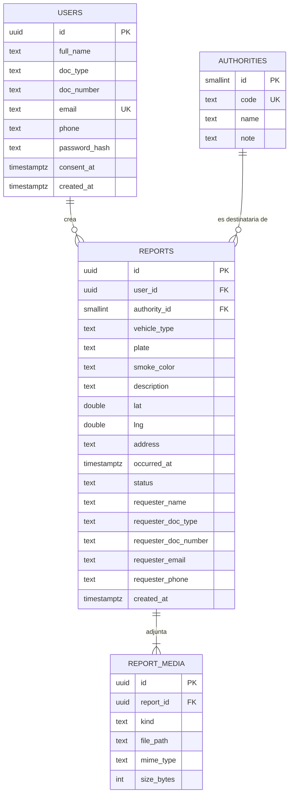

# 05 · Modelo de datos y API

## Modelo entidad–relación



## Esquema SQL inicial (`backend/src/db/migrations/001_init`)

```sql
CREATE TABLE authorities (
  id smallserial PRIMARY KEY,
  code text NOT NULL UNIQUE,
  name text NOT NULL,
  note text
);

CREATE TABLE users (
  id uuid PRIMARY KEY DEFAULT gen_random_uuid(),
  full_name text NOT NULL,
  doc_type text NOT NULL CHECK (doc_type IN ('CC','CE','PAS')),
  doc_number text NOT NULL,
  email text NOT NULL UNIQUE,
  phone text,
  password_hash text NOT NULL,
  consent_at timestamptz NOT NULL,
  created_at timestamptz NOT NULL DEFAULT now(),
  updated_at timestamptz NOT NULL DEFAULT now()
);

CREATE TABLE reports (
  id uuid PRIMARY KEY DEFAULT gen_random_uuid(),
  user_id uuid NOT NULL REFERENCES users(id) ON DELETE CASCADE,
  authority_id smallint NOT NULL REFERENCES authorities(id),
  vehicle_type text NOT NULL CHECK (vehicle_type IN ('bus','microbus','camion','tractomula','otro')),
  plate text NOT NULL,
  smoke_color text NOT NULL CHECK (smoke_color IN ('negro','gris','blanco')),
  description text,
  lat double precision NOT NULL CHECK (lat BETWEEN -90 AND 90),
  lng double precision NOT NULL CHECK (lng BETWEEN -180 AND 180),
  address text,
  occurred_at timestamptz NOT NULL,
  status text NOT NULL DEFAULT 'generado' CHECK (status IN ('generado','enviado')),
  requester_name text NOT NULL,
  requester_doc_type text NOT NULL,
  requester_doc_number text NOT NULL,
  requester_email text NOT NULL,
  requester_phone text,
  created_at timestamptz NOT NULL DEFAULT now()
);
CREATE INDEX idx_reports_user_created ON reports (user_id, created_at DESC);
CREATE INDEX idx_reports_occurred ON reports (occurred_at);
CREATE INDEX idx_reports_coords ON reports (lat, lng);

CREATE TABLE report_media (
  id uuid PRIMARY KEY DEFAULT gen_random_uuid(),
  report_id uuid NOT NULL REFERENCES reports(id) ON DELETE CASCADE,
  kind text NOT NULL CHECK (kind IN ('photo','video')),
  file_path text NOT NULL,
  mime_type text NOT NULL,
  size_bytes integer NOT NULL
);
CREATE INDEX idx_media_report ON report_media (report_id);
```

**Datos iniciales (`authorities`):**

| code | name |
|---|---|
| `CAR` | Corporación Autónoma Regional de Cundinamarca (CAR) |
| `SDA` | Secretaría Distrital de Ambiente de Bogotá |
| `SDM` | Secretaría Distrital de Movilidad de Bogotá |

El campo `note` queda con «VERIFICAR canal oficial de radicación antes de la demo». Mateo confirmará los
canales oficiales; no los inventes.

## Convenciones del API
- Prefijo `/api`. JSON en UTF-8. Fechas en ISO 8601 (UTC).
- Autenticación: cabecera `Authorization: Bearer <token>` en todo salvo `/health`, `/auth/register`, `/auth/login`.
- Errores: `{ "error": { "code": "VALIDATION_ERROR", "message": "texto en español", "details": [...] } }`
  con códigos HTTP 400, 401, 403, 404, 409, 413, 429, 500.
- Límites: peticiones globales 100 cada 15 min por IP; `/auth/*` 10 cada 15 min.

## Endpoints

| Método y ruta | Descripción | Cuerpo / parámetros | Respuesta |
|---|---|---|---|
| `GET /health` | Estado del servicio | — | `200 {status:"ok"}` |
| `POST /auth/register` | Crear cuenta | `full_name, doc_type, doc_number, email, phone?, password (≥8), accept_terms:true` | `201 {token, user}` · `409` correo duplicado |
| `POST /auth/login` | Iniciar sesión | `email, password` | `200 {token, user}` · `401` |
| `GET /me` | Perfil | — | `200 {user}` |
| `PUT /me` | Editar perfil | `full_name, doc_type, doc_number, phone?` | `200 {user}` |
| `GET /authorities` | Lista de autoridades | — | `200 [{id, code, name}]` |
| `GET /geo/reverse` | Dirección desde coordenadas | `lat, lng` | `200 {address, municipality, state, suggested_authority_id}` |
| `POST /reports` | Crear reporte | `multipart/form-data`: `vehicle_type, plate, smoke_color, description?, lat, lng, address?, occurred_at, authority_id?, requester_name, requester_doc_type, requester_doc_number, requester_email, requester_phone?` + `files[]` (1–3) | `201 {report}` |
| `GET /reports` | Mis reportes | `page=1, limit=20, status?` | `200 {items, page, total}` |
| `GET /reports/:id` | Detalle | — | `200 {report, media[], authority}` · `404` si no es suyo |
| `DELETE /reports/:id` | Eliminar | — | `204` |
| `PATCH /reports/:id/status` | Marcar como enviado | `{status:"enviado"}` | `200 {report}` |
| `GET /reports/:id/media/:mediaId` | Descargar un archivo de evidencia | — | archivo |
| `GET /reports/:id/pqrsd` | Texto de la solicitud | — | `200 {authority, text}` |
| `GET /reports/:id/pqrsd.pdf` | PDF de la solicitud | — | `200 application/pdf` |
| `GET /map/reports` | Reportes para el mapa | `vehicle_type?, from?, to?` | `200 [{id, lat, lng, vehicle_type, occurred_at}]` |

Ejemplo de respuesta de `POST /reports` (resumen):
```json
{ "report": { "id": "…", "vehicle_type": "bus", "plate": "ABC123", "smoke_color": "negro",
  "lat": 4.5794, "lng": -74.2168, "address": "…", "occurred_at": "2026-11-17T14:30:00Z",
  "status": "generado", "authority": {"id": 1, "code": "CAR", "name": "…"} } }
```

## Validaciones
- `vehicle_type`: `bus | microbus | camion | tractomula | otro`. `smoke_color`: `negro | gris | blanco`.
- `plate`: normalizar (mayúsculas, sin espacios ni guiones) y validar `^[A-Z]{3}\d{3}$` o `^[A-Z]{3}\d{2}[A-Z]$`.
- `lat` entre −90 y 90; `lng` entre −180 y 180; `occurred_at` no puede ser futura.
- `description` hasta 500 caracteres. `password` mínimo 8 caracteres. `email` con formato válido y único.
- Archivos: de 1 a 3; imágenes `image/jpeg|png|webp` ≤ 8 MB; video `video/mp4|quicktime` ≤ 25 MB.
- `accept_terms` debe ser `true`; se guarda `consent_at = now()`.

## Asignación de la autoridad (propuesta; **Mateo debe validarla**)
1. `GET /geo/reverse` obtiene de Nominatim (`format=jsonv2&addressdetails=1&accept-language=es&zoom=16`)
   ciudad/municipio/departamento.
2. Se normaliza el texto (minúsculas, sin tildes). Si contiene `bogota` → **SDA**. Si contiene `soacha` o
   `cundinamarca` → **CAR**. En otro caso → sin sugerencia; el usuario elige.
3. El servidor repite la regla al crear el reporte si no llega `authority_id`.
4. Probar con coordenadas reales aproximadas: Soacha ≈ 4.579, −74.217; centro de Bogotá ≈ 4.610, −74.082.
5. **Cache:** en memoria, clave = coordenadas redondeadas a 4 decimales, TTL 24 h; cola para no superar
   1 petición por segundo; cabecera `User-Agent` desde `NOMINATIM_USER_AGENT`.

## Plantilla de la solicitud (texto y PDF)

Tamaño carta, fuente legible (Helvetica de `pdfkit`), márgenes de 2,5 cm. La primera foto del reporte se
incrusta reducida (≈ 6 cm de ancho) si existe; si solo hay video, se lista el nombre del archivo.

```
{ciudad}, {fecha de generación en español}

Señores
{nombre de la autoridad}
Ciudad

Asunto: Denuncia ciudadana por presunta emisión anómala de gases contaminantes de una fuente móvil –
vehículo de placa {placa}

Respetados señores:

En ejercicio del derecho fundamental de petición consagrado en el artículo 23 de la Constitución Política
de Colombia, y con el fin de que se adelanten las verificaciones que sean de su competencia, presento la
siguiente denuncia ciudadana.

HECHOS
1. El día {fecha} a las {hora}, en {dirección} (coordenadas {lat}, {lng}), observé un vehículo de tipo
   {tipo de vehículo} con placa {placa} que emitía humo de color {color}.
2. {descripción, solo si existe}
3. Como soporte se anexan {n} archivo(s) de evidencia ({fotografía/video}) registrados con la fecha, la hora
   y la ubicación indicadas.

PETICIÓN
Solicito respetuosamente a la entidad:
1. Verificar los hechos descritos dentro del ámbito de sus competencias.
2. Adelantar, si hay lugar a ello, las actuaciones administrativas correspondientes.
3. Informarme sobre el trámite dado a esta solicitud. Si no es la entidad competente, remitirla a la
   autoridad que corresponda e informarme de ello.

NOTIFICACIONES
Recibiré notificaciones en el correo {correo}{ y en el teléfono {teléfono}}.

Atentamente,

{nombre completo}
{tipo de documento} {número de documento}

Nota: Este documento fue generado con la aplicación AireClaro a partir de un reporte ciudadano. Las
observaciones corresponden a lo percibido por el peticionario y no constituyen una medición técnica de
emisiones. Reporte n.º {id corto}.
```
Tono: factual, sin acusar ni calificar. No afirmar que el vehículo «incumple» la norma.

> Nota para Mateo: el marco jurídico del documento maestro cita la Ley 1437 de 2011 para el derecho de
> petición. Verifica si conviene mencionar también la Ley 1755 de 2015, que regula el derecho fundamental
> de petición y sustituyó el Título II de esa ley. La plantilla evita citar una norma concreta de forma
> deliberada.
