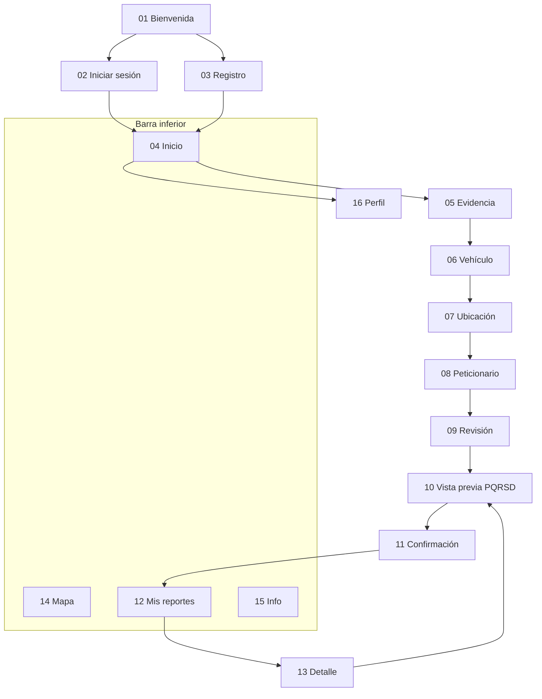

# 06 · Diseño del front (app Flutter)

> **Regla:** el prototipo de Figma de Mateo manda sobre este documento. Este archivo define estructura,
> contenido, textos, validaciones y comportamiento. Si hay diferencias visuales, sigue Figma y avisa.

## Navegación

Rutas (`go_router`): `/welcome`, `/login`, `/register`, `/home`, `/report/evidence`, `/report/vehicle`,
`/report/location`, `/report/requester`, `/report/review`, `/report/:id/preview`, `/report/:id/done`,
`/reports`, `/reports/:id`, `/map`, `/info`, `/profile`. Redirección: sin sesión → `/welcome`; con sesión
y en `/welcome|/login|/register` → `/home`. La barra inferior (Inicio, Mapa, Mis reportes, Info) está solo en
las cuatro pantallas principales.

## Estilo (valores por defecto si Figma no los define)

| Elemento | Valor |
|---|---|
| Material | Material 3, tema claro; todo el estilo en un `ThemeData` central |
| Color primario | `#0E7C86` (verde azulado, «aire») · contenedor `#CDEFF1` |
| Fondo / superficie | `#F7FAFA` / `#FFFFFF` · texto `#1C2B2D` |
| Estados | éxito `#2E7D32` · alerta `#ED6C02` · error `#B3261E` |
| Tipografía | La por defecto de Flutter/Material (Roboto). Títulos 22–24, cuerpo 16, etiquetas 14 |
| Espaciado | Múltiplos de 8; márgenes de pantalla de 16; radios de 12 |
| Botones | Altura 48; primario relleno; secundario con borde; deshabilitado en gris |
| Accesibilidad | Objetivo táctil ≥ 48 dp, contraste suficiente, etiquetas en los campos, no depender solo del color |

Componentes compartidos: `PrimaryButton`, `SecondaryButton`, `AppTextField`, `AppDropdown`, `StepProgress`,
`ReportCard`, `EmptyState`, `ErrorState` (con «Reintentar»), `LoadingOverlay`, `SectionTitle`.

## Textos fijos
- Nombre de la app: **AireClaro** · frase: «Reporta vehículos contaminantes en el corredor Soacha–Bogotá».
- Aviso de alcance: «AireClaro no mide emisiones ni impone sanciones. Genera una solicitud con la evidencia que tú aportas.»
- Atribución del mapa (siempre visible): «© OpenStreetMap contributors».

## Pantallas

### 01 · Bienvenida
Logo y nombre, frase, botón primario «Iniciar sesión», botón secundario «Crear cuenta».

### 02 · Iniciar sesión
Título «Iniciar sesión». Campos: **Correo electrónico**, **Contraseña** (mostrar/ocultar). Botón «Ingresar»
(deshabilitado si hay campos vacíos o inválidos). Enlace «¿No tienes cuenta? Crear cuenta».
Errores: formato de correo; «Correo o contraseña incorrectos» (mensaje genérico). Sin conexión: `ErrorState`.

### 03 · Registro
Título «Crear cuenta». Campos: **Nombre completo**, **Tipo de documento** (CC, CE, PAS), **Número de documento**,
**Correo electrónico**, **Teléfono (opcional)**, **Contraseña** (mín. 8), **Confirmar contraseña**.
Casilla: «Acepto el tratamiento de mis datos personales» + enlace «Ver política completa» (texto breve en un
diálogo: qué datos se recogen —ubicación, fotos, placa, datos de contacto—, para qué —generar la solicitud— y
la Ley 1581 de 2012). Botón «Crear cuenta», deshabilitado hasta que todo sea válido y la casilla esté marcada.
Errores: «Este correo ya está registrado», «Las contraseñas no coinciden».

### 04 · Inicio
Encabezado: «Hola, {nombre}» y botón de perfil (ícono). Botón principal grande «Nuevo reporte».
Tarjetas: «Mis reportes» (con el número de reportes), «Mapa de reportes», «¿Cómo funciona?». Barra inferior.

### 05 · Nuevo reporte, paso 1 de 4: Evidencia
`StepProgress` 1/4. Título «Captura la evidencia». Botones: «Tomar foto», «Grabar video (máx. 15 s)»,
«Elegir de la galería». Miniaturas con botón para quitar (los videos muestran una tarjeta «Video» con ícono y
tamaño; sin duración, ver cambio del 16-nov-2026 en `docs/02`).
Ayuda: «Procura que se vea la placa y el humo». Máximo 3 archivos. «Siguiente» activo con ≥ 1 archivo.
Fotos: `imageQuality ≈ 80`, `maxWidth ≈ 1600`. La cámara se abre con la app de cámara del sistema (no se declara
el permiso `CAMERA`, ver `docs/04`).

### 06 · Paso 2 de 4: Datos del vehículo
**Tipo de vehículo** (desplegable: Bus o buseta, Microbús, Camión, Tractomula, Otro) · **Placa** (mayúsculas
automáticas, ejemplo `ABC123`, validación `ABC123` o `ABC12D`) · **Color del humo** (Negro, Gris, Blanco; chips)
· **Descripción (opcional)** hasta 500 caracteres con contador. Botones «Atrás» y «Siguiente».

### 07 · Paso 3 de 4: Ubicación y hora
Mapa (`flutter_map`) con un pin en la posición GPS actual; el usuario puede mover el pin. Debajo: dirección
aproximada (desde `GET /geo/reverse`), fecha y hora automáticas (solo lectura). Botón «Usar mi ubicación actual».
Si no hay permiso: aviso «Necesitamos tu ubicación para registrar dónde ocurrió» y botón «Activar ubicación».
Atribución de OSM visible. Centro por defecto del mapa si no hay GPS: ≈ (4.595, −74.15), zoom 12.

### 08 · Paso 4 de 4: Datos del peticionario
Campos precargados desde el perfil y editables: **Nombre completo**, **Tipo y número de documento**,
**Correo**, **Teléfono (opcional)**. Nota: «Estos datos se usan para generar tu solicitud.» Botón «Revisar reporte».
(No hay opción anónima.)

### 09 · Revisión
Resumen: miniatura de la evidencia, tipo de vehículo, placa, color del humo, descripción, mapa pequeño con
dirección, fecha y hora, y **autoridad destinataria** sugerida con enlace «Cambiar» (lista de autoridades).
Enlaces «Editar» por sección. Botón primario «Generar solicitud» → crea el reporte (`POST /reports`) con
`LoadingOverlay` y navega a la vista previa. Errores: archivo muy grande, sin conexión («Reintentar»).

### 10 · Vista previa de la solicitud
Tarjeta desplazable con el texto de la solicitud (`GET /reports/:id/pqrsd`) y el nombre de la autoridad.
Botones, en este orden:
1. **«Enviar a la autoridad»** (primario; solo si `can_email`). Abre un diálogo: «Se enviará tu solicitud con el
   PDF y la evidencia a {autoridad}. Recibirás una copia en {correo} y la respuesta llegará a ese correo.»
   Botones «Cancelar» / «Enviar». En modo de prueba se muestra un aviso: «Modo de prueba: el correo va a un
   buzón de prueba, no a la autoridad».
2. **«Radicar en el portal oficial»** (secundario; para toda autoridad con `portal_url`): abre el navegador.
3. «Descargar PDF» (descarga y abre) y «Compartir» (menú del teléfono).
4. «Continuar».
No hay edición aquí: para cambiar algo se vuelve a la revisión antes de guardar. Si el envío falla: mensaje y
«Reintentar».

### 11 · Confirmación
Ícono de éxito, número corto del reporte y resumen. El título depende del caso:
- **Enviado por correo:** «Solicitud enviada a {autoridad}».
- **Solo generado:** «Reporte generado», con la opción «Marcar como enviado» (PATCH de estado, `manual`).
Bloque **«¿Cómo hacer seguimiento?»** (solo texto): la entidad debe responder al correo del peticionario; el
término general de respuesta es de 15 días siguientes a la recepción (Ley 1755 de 2015); si la entidad no es la
competente, debe remitirla a la que corresponda. Si se envió por correo, recuerda revisar la copia recibida.
Botones «Ver mis reportes» y «Volver al inicio».

### 12 · Mis reportes
Lista de `ReportCard` (miniatura, placa, tipo, fecha, chip de estado «Generado» / «Enviado»), más reciente
primero, con paginación al desplazar. Estado vacío: «Aún no tienes reportes» y botón «Nuevo reporte».

### 13 · Detalle del reporte
Carrusel de evidencia, datos completos, mapa pequeño, autoridad, estado. Botones: «Descargar solicitud»,
«Compartir», «Enviar a la autoridad» (si no se ha enviado y `can_email`), «Radicar en el portal oficial»,
«Marcar como enviado» y «Eliminar» (con confirmación; prioridad Could). El chip de estado indica «Enviado por correo» o «Enviado (manual)».

### 14 · Mapa de reportes
Mapa con pines (`GET /map/reports`), filtros por tipo de vehículo y rango de fechas (chips o diálogo). Al tocar
un pin: tarjeta inferior con tipo de vehículo y fecha (sin dirección, RB-07). **Sin placa ni foto.** Atribución de OSM.

### 15 · Información: ¿Cómo funciona?
Pasos (1. Captura la evidencia · 2. Completa los datos · 3. Genera la solicitud · 4. Preséntala a la autoridad),
autoridades a las que se dirige (CAR, Secretaría Distrital de Ambiente, Secretaría Distrital de Movilidad),
aviso de alcance y enlace a la política de datos.

### 16 · Perfil
Datos (nombre, documento, correo, teléfono). «Editar» (nombre, documento, teléfono; el correo no se edita),
enlace a la política de datos y botón «Cerrar sesión».

### 17 · Estados y errores (variantes de las pantallas anteriores)
- Cargando: indicador con texto.
- Sin conexión o error del servidor: `ErrorState` con mensaje claro y «Reintentar». **No hay modo sin conexión
  ni borradores** (fuera de alcance).
- Permiso de cámara o ubicación denegado: explicación y botón para abrir los ajustes.
- Sesión expirada (401): volver a «Iniciar sesión» con el mensaje «Tu sesión expiró».
- Listas vacías: `EmptyState`.

## Estado de la app (Riverpod)
- `authController`: usuario y token (token en `flutter_secure_storage`).
- `reportDraftController`: borrador del reporte en memoria durante los pasos 1–4 (se pierde al salir).
- `reportsController`: lista paginada de mis reportes.
- `mapController`: reportes del mapa y filtros.
- Cliente HTTP (`dio`) con interceptor que agrega el token y maneja el 401.
